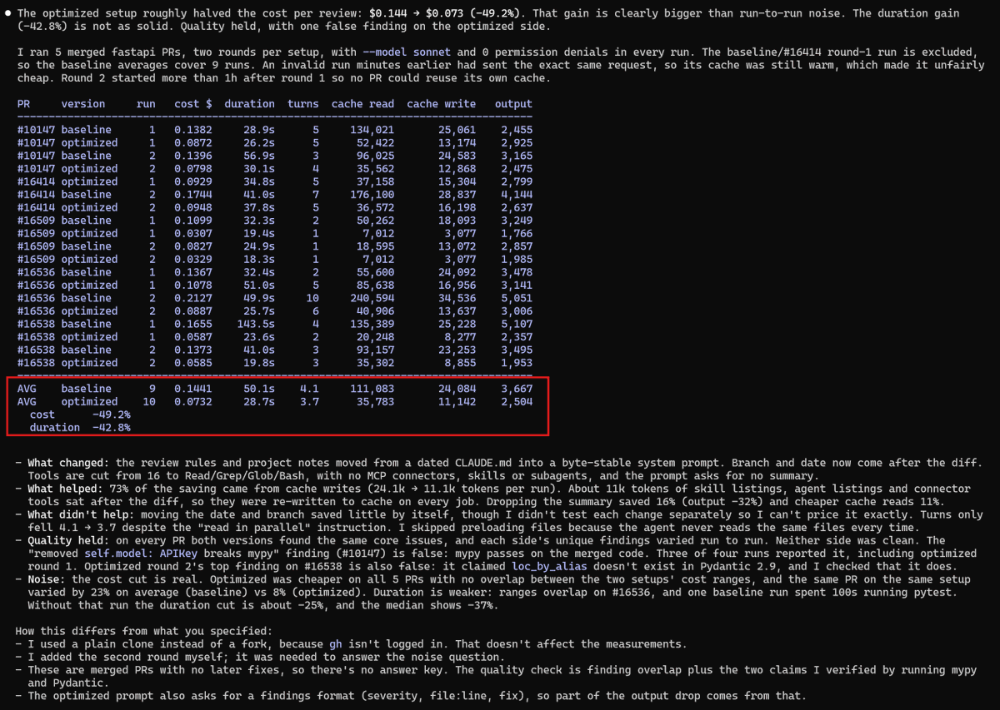

# cache-tune

A Claude Code skill that makes an agent's prompt cache-friendly, so repeated `claude -p` runs cost less
and the agent does the same work.

## Results

One test: Claude Code with `--model sonnet` reviewed 5 merged fastapi PRs, 2 rounds per setup, with no
permission denials. Round 2 started more than an hour after round 1, so no PR reused its own cache. One
baseline run was dropped because an invalid run minutes earlier had warmed its cache, so the "before"
means cover 9 runs and the "after" means cover 10.

| Mean per review | Before | After | Change | Share of the saving |
|---|---|---|---|---|
| Cost | $0.1441 | $0.0732 | -49.2% | |
| Cache writes | 24,084 tokens | 11,142 tokens | -53.7% | 73% |
| Output | 3,667 tokens | 2,504 tokens | -31.7% | 16% |
| Cache reads | 111,083 tokens | 35,783 tokens | -67.8% | 11% |
| Duration | 50.1 s | 28.7 s | -42.8% | |
| Turns | 4.1 | 3.7 | -10% | |

- **Cost:** cheaper on all 5 PRs, and the cost ranges of the two setups did not overlap. The same PR on
  the same setup varied by 23% on average before and by 8% after.
- **Duration:** unproven. The ranges overlap on one PR, and one "before" run spent 100 s running pytest.
  Without that run the cut is about 25%; the median fell by 37%.
- **Output:** part of the drop comes from the fixed findings format, not only from dropping the summary.
- **Quality held:** on every PR both setups found the same core issues, and each side's unique findings
  varied from run to run. Neither side was clean: a false mypy claim on one PR came up in 3 of 4 runs,
  one of them on the "after" side, and an "after" run's top finding on another PR was also false.

What changed:

1. The project notes moved from a CLAUDE.md that also held the date and branch into a byte-stable system
   prompt file (`--append-system-prompt-file`), together with the review instructions.
2. Branch and date moved out of CLAUDE.md into the prompt, just before the diff.
3. Tools cut from 14, plus 39 more tool names listed after the diff (16 built-in, 23 from claude.ai
   connectors), to Read/Grep/Glob/Bash, with no MCP connectors, skills or subagents. About 11k tokens of
   skill listings, agent listings and connector tools had been sitting after the diff and were written to
   cache again on every run.
4. The instructions changed from "find bugs and risks, then write a summary" to findings only, in a fixed
   format (severity, file:line, what, why, fix), with no summary. They also say that the diff is not
   applied, that files must not be modified, and that independent reads should go out in parallel.

The changes were not tested one by one, so their separate effects are estimates; moving the date and
branch probably saved little on its own.

The scripts, both prompts, the 5 diffs and the raw `claude -p` output of every run, including the
excluded ones, are in [benchmarks/fastapi-review](benchmarks/fastapi-review). You can rebuild the table
from the raw files with one command, or run the whole test again. The report as the original session
printed it:



## What the skill does

1. **Audits** CLAUDE.md, AGENTS.md, `.claude/settings.json`, MCP servers, skills, subagents and the
   scripts that run headless `claude -p` jobs. It flags values that change per run (dates, branch names,
   run IDs, timestamps) inside the stable part of the prompt, and bulky text placed after the per-run part.
2. **Proposes a plan** and applies it only after you confirm:
   - stable rules in one byte-identical block at the top (`--append-system-prompt-file`)
   - per-run data (task, diff, branch, date) at the very end
   - only the tools the job uses, with MCP servers, skills and subagents off where the job doesn't need them
   - a fixed output format with no closing summary
3. **Shows the diff** of every changed file.
4. **Benchmarks** before against after: the same tasks N times through both setups with
   `claude -p --output-format json`, printing cost, duration, cache reads, cache writes and averages.

It changes only how the prompt is assembled, never what the agent is told to do. Model, effort,
permissions and rule text stay as they are.

## Install

```bash
npx skills add undefined-ui/cache-tune -g
```

This uses the [skills](https://github.com/vercel-labs/skills) CLI (needs Node.js) and installs the skill for
your user. Leave out `-g` to install it into the current project only. Restart Claude Code.

Without Node.js, copy the skill folder into your user skills:

```bash
git clone https://github.com/undefined-ui/cache-tune
cp -r cache-tune/skills/cache-tune ~/.claude/skills/
```

Or into one project:

```bash
cp -r cache-tune/skills/cache-tune <your-project>/.claude/skills/
```

## Use

In the project that runs the agent, type:

```text
/cache-tune
```

or ask in your own words, for example "make our PR review job cheaper". The skill audits, shows the plan
and waits for your yes. Before each probe or benchmark it says how many `claude` calls it will make and
asks.

The benchmark also runs on its own:

```bash
scripts/bench.sh -n 2 bench/before.sh bench/after.sh main~2..main~1 main~1..main
```

```bash
scripts/bench.sh --probe bench/before.sh bench/after.sh
```

A setup file is a short bash file with `CLAUDE_ARGS`, a `build_prompt` function and an optional `WORKDIR`.
See [the benchmark reference](skills/cache-tune/reference/benchmark.md) and
[the template](skills/cache-tune/templates/setup.example.sh). `--probe` makes one short haiku call per
setup and lists the tools, MCP servers and skills it loads, with the size of its fixed prefix.

Needs bash, the Claude Code CLI, and python3 or node. Works on macOS, Linux and Windows Git Bash.

## Credit

The idea comes from [Cloudflare's blog post](https://blog.cloudflare.com/obsessive-inference-optimization/)
of Oct 19, 2026. 77% of their AI code review bill was cache writes and reads, and only 14-26% of first
requests hit the cache. Their fix was to split the prompt so the static part gets its own cache
breakpoint. The cache fix alone took them from $2.47 to $2.02 per review; most of their total savings
($2.43 to $0.77) came from switching models and effort levels.

## License

MIT
