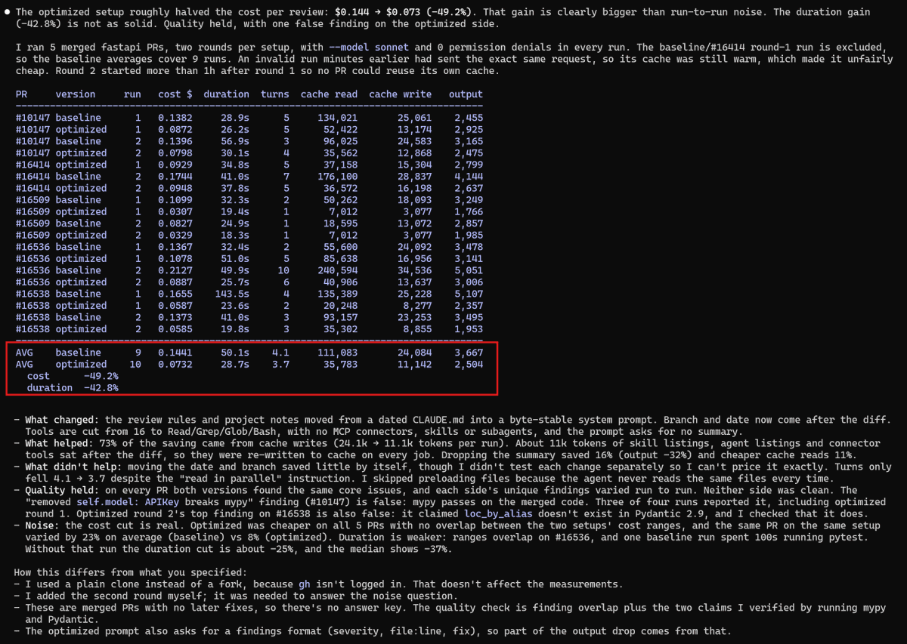

# fastapi review benchmark

The test behind the [results in the main README](../../README.md#results). Claude Code reviewed 5 merged
fastapi PRs with a typical setup (baseline) and a cache-friendly setup (optimized), 2 rounds each.

This folder holds the scripts and prompts that ran, the 5 diffs, and the raw
`claude -p --output-format json` output of every run, including the runs left out of the averages.



## Check the numbers without running anything

```bash
python3 report.py results 1 2
```

```bash
python3 shares.py results 1 2
```

`report.py` builds the table from the raw `result.json` files. Its output is identical to
`report-table.txt`, the table the original session printed. `shares.py` splits the saving by token type.
In every published run, `total_cost_usd` equals the usage priced at $2 per million input tokens, $4 for
cache writes (Claude Code uses the 1-hour TTL), $0.10 for cache reads and $10 for output. `shares.py`
checks this for each run.

Each `result.json` also holds the review text (`result`), the session ID and the usage per model, so you
can read what each setup found.

## Reproduce

Needs bash, git, Claude Code and python3 (or python). The original 20 runs of the two rounds cost about $2.10.

```bash
git clone https://github.com/fastapi/fastapi.git fastapi-bench
export FASTAPI_DIR="$PWD/fastapi-bench"
bash round.sh 1
```

Wait at least 65 minutes, so no PR reads the cache its own round-1 run wrote, then:

```bash
bash round.sh 2
python3 report.py runs 1 2
```

Before you run it:

- `run.sh` starts claude with `--permission-mode bypassPermissions`, as the original did, so the agent can
  run any command in the clone (it ran pytest and mypy). Use a machine or container where that is fine.
  Each run also force-checks out a commit and runs `git clean -fdx` in `FASTAPI_DIR`.
- Your numbers will differ. Model output varies from run to run, and the baseline cost depends on what
  your Claude Code loads by default. The original baseline loaded 14 tools, 39 more tool names listed for
  later loading (16 built-in, 23 from claude.ai connectors), 7 subagent types and 37 skills. A clean
  install loads less, so its baseline is cheaper and the gap is smaller. The optimized setup loads the
  same 4 tools everywhere.
- The original ran on 2026-10-30 with Claude Code 2.1.314 and `--model sonnet` (`claude-sonnet-5-5`), in
  Git Bash on Windows.

## What is here

| Path | What |
|------|------|
| `run.sh` | one review: checks out the PR's parent commit, applies a setup, runs `claude -p`, saves the result |
| `round.sh` | the 5 PRs with the baseline setup, then with the optimized setup |
| `baseline/` | CLAUDE.md template with date and branch, a generic prompt, default tools |
| `optimized/` | `system-static.md` passed with `--append-system-prompt-file`, 4 tools, no MCP, skills or subagents |
| `diffs/`, `parents.txt` | the 5 PR diffs and the parent commit each review runs on |
| `results/` | per run: `result.json`, `wallclock.txt` and, for the baseline, the CLAUDE.md it saw |
| `results/excluded/` | runs left out of the averages (see below) |
| `report.py`, `report-table.txt` | builds the table; the table from the original session |
| `shares.py` | splits the saving by token type |
| `screenshot.png` | the report as the original session showed it |

## Excluded runs

- `baseline-r1-pr3-16414-warm-cache`: a run minutes earlier had sent the same request, so this one read a
  warm cache and was unfairly cheap. Round 2 measured this PR again. Its review text still counts for the
  quality comparison.
- `baseline-r1-pr2-...` to `pr5-...-checkout-failed`: the first attempt at PRs 2-5. Checking out the
  parent commit failed in Git Bash (`fatal: '^' is not a commit`), so the agent reviewed the wrong tree.
  The runs after it read the parent commits from `parents.txt`, and `run.sh` stops if HEAD does not match.

## Not published

The session transcripts are not here. They contain account details (an email address and an organization
ID) and the full system prompt of the machine that ran them. The numbers come from `result.json` alone.

## Changes from the scripts that produced the data

These changes only make the scripts run on other machines. The prompts, flags and run order are the same.

- Paths come from the script's folder and `FASTAPI_DIR` instead of being hard-coded.
- `cygpath` is used only where it exists (Git Bash).
- Paths are quoted, the empty argument list works in bash 3.2, and timestamps use `date +%s`.
- `run.sh` no longer copies the transcript.
- New runs go to `runs/` (ignored by git). `round.sh` is the original `round2.sh` with the round as an
  argument.
- `report.py` takes the results folder as its first argument.
